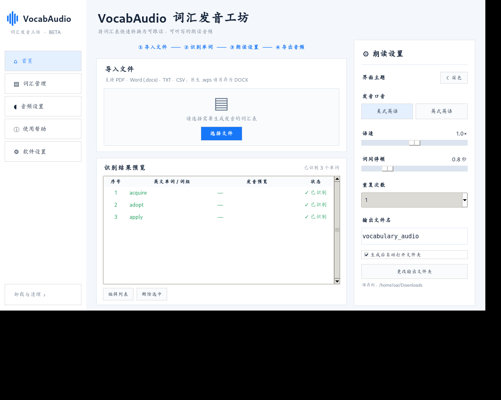
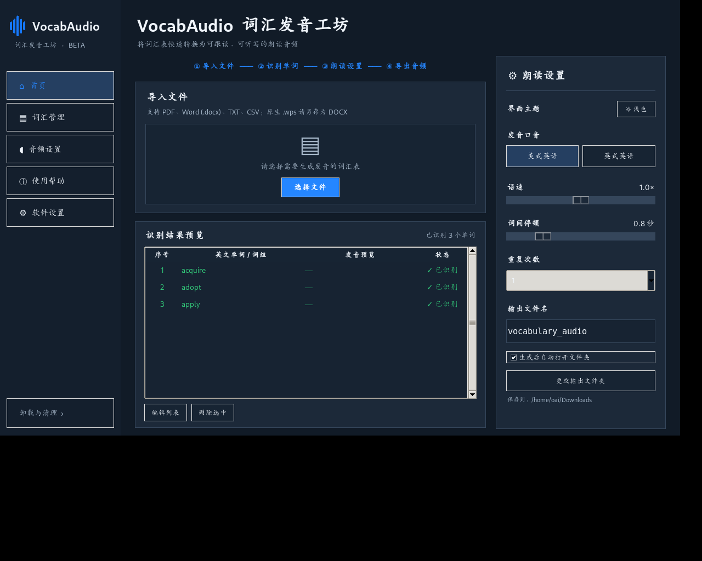

# VocabAudio 2.0 Beta

[中文与英文完整说明 / Full bilingual guide](README.md)

# VocabAudio 2.0 Beta · 词汇发音工坊

将词汇表转换为可跟读、可听写的 MP3，支持浅色／深色办公风格界面。  
Turn vocabulary lists into MP3 audio for listening, dictation and pronunciation practice, with a light/dark office-style interface.

[下载 Windows 版 / Download for Windows](https://github.com/cty051111-alt/VocabAudio/releases/tag/v2.0.0-beta) · [English README](README_EN.md)

## 快速开始 / Quick start

1. 在 Release 的 **Assets** 中下载 **VocabAudio_Windows_Beta.zip**，完整解压到独立文件夹。  
   Download **VocabAudio_Windows_Beta.zip** under **Assets** and extract it into a separate folder.
2. 双击 **VocabAudio.exe**，无需安装 Python。  
   Double-click **VocabAudio.exe**; Python installation is not required.
3. 导入词汇表，检查识别结果，选择发音口音、语速、停顿和重复次数，再生成 MP3。  
   Import a vocabulary list, review the detected words, choose accent, speed, gaps and repetitions, then generate an MP3.

请下载上述 Windows 包；GitHub 自动提供的 **Source code** 是源码，不是可直接运行的 EXE。EXE 未数字签名，Windows 可能显示未知发布者提示。  
Use the Windows ZIP above. GitHub's **Source code** archives contain source files, not a ready-to-run EXE. The executable is unsigned, so Windows may show an unknown-publisher notice.

## 功能 / Features

| 中文 | English |
| --- | --- |
| 导入带文字层的 PDF、DOCX、TXT、CSV | Import text-based PDF, DOCX, TXT and CSV files |
| 提取英文词条，保留顺序，支持编辑、删除和去重 | Extract headwords in order; edit, remove and deduplicate entries |
| 美式／英式发音、语速、词间停顿、重复 1–5 次 | US/UK pronunciation, adjustable speed and gaps, 1–5 repetitions |
| 下载发音并合成为 MP3，输出失败词清单 | Download pronunciation clips, combine them into MP3 and report failed words |
| 浅色／深色主题，自动保存设置 | Light/dark themes with persistent local settings |
| 提供需确认的卸载脚本 | Includes an uninstaller requiring confirmation |

## 界面预览 / Interface previews

### 浅色 / Light


### 深色 / Dark


以上为源码包随附的界面截图，并非本次 Windows 人工测试截图。  
These previews were supplied with the source package; they are not evidence of manual Windows testing in this release.

## 已验证范围 / Validation

- Windows GitHub Actions：Python 3.10、3.13 的 11 项离线测试均通过。  
  All 11 offline tests passed on Windows with Python 3.10 and 3.13.
- Windows 独立 EXE 已构建，执行离线自检成功；发行 ZIP 已下载并检查完整性。  
  The standalone Windows EXE was built and passed its offline self-test; the published ZIP was downloaded and checked for integrity.
- 在线发音下载、实际 Windows 界面操作和卸载仍需人工实测。  
  Live pronunciation downloads, interactive Windows UI behavior and uninstallation still require manual testing.

## 隐私与音源 / Privacy and pronunciation source

原文档在本机解析，不会上传整个文件；生成音频时，英文词条会发送到第三方有道发音接口。此接口非官方公开支持接口，项目与有道／网易无关联，服务可能变化、限流或失效。  
Documents are parsed locally and are not uploaded in full. When generating audio, English entries are sent to a third-party Youdao pronunciation endpoint. This is an unofficial endpoint; this project is not affiliated with Youdao/NetEase, and the service may change, restrict access or become unavailable.

音频不保证为真人录音。MIT 许可仅覆盖项目自身代码，不授予第三方音频或依赖项的额外使用权；请遵守相应许可，不要未经许可重新分发录音。  
Audio is not guaranteed to be human-recorded. The MIT license covers this project's own code and does not grant additional rights to third-party audio or dependencies. Respect their applicable licenses and do not redistribute recordings without permission.

## 已知限制 / Known limitations

- 扫描版 PDF 需先 OCR；旧版原生 WPS／DOC 应先另存为 DOCX。  
  Scanned PDFs require OCR; legacy native WPS/DOC files should be converted to DOCX.
- 任意 PDF 排版不保证完全识别，请在生成前检查词表。  
  Arbitrary PDF layouts may not be parsed accurately; review the word list before generation.
- 音标预览显示“—”，当前不会自动生成 IPA。  
  The transcription preview displays a dash; automatic IPA generation is not implemented.
- 失败词不会包含在输出音频中，请查看失败报告。  
  Failed words are omitted from the output audio; review the failure report.

## 卸载 / Uninstallation

退出程序后运行 `Uninstall_VocabAudio.bat`，查看清理范围并输入 `UNINSTALL` 确认。请将软件保存在独立文件夹，勿将个人文件放进程序的 scripts、tests、docs 等子目录：卸载脚本会递归清理这些列入名单的子目录。  
Close the app and run `Uninstall_VocabAudio.bat`. Review its scope and type `UNINSTALL` to confirm. Keep the app in a separate folder and do not store personal files inside its scripts, tests or docs subdirectories: the uninstaller recursively removes these allow-listed subdirectories.

应用设置位于 `%LOCALAPPDATA%\VocabAudio`。导入文档和导出 MP3 请保存在程序子目录之外；脚本不卸载系统 Python。  
Settings are stored in `%LOCALAPPDATA%\VocabAudio`. Keep imported documents and exported MP3s outside the program subdirectories; the script does not uninstall system Python.

## 源码运行与开发 / Running from source and development

需要 Python 和依赖；Windows CI 已验证 Python 3.10、3.13。  
Python and dependencies are required; Windows CI has tested Python 3.10 and 3.13.

```bash
python -m pip install -r requirements.txt
python app.py
```

离线测试 / Offline tests:

```bash
python -m pip install -r requirements-dev.txt
python -m pytest -q
python app.py --self-test
```

`app.py`：界面 / UI · `vocab_core.py`：词汇提取与音频处理 / parsing and audio · `settings_store.py`：设置 / preferences

## 许可 / License

项目自身代码采用 [MIT License](LICENSE)。第三方依赖和音频遵循各自许可。  
This project's own code is released under the [MIT License](LICENSE). Third-party dependencies and audio retain their respective licenses.
